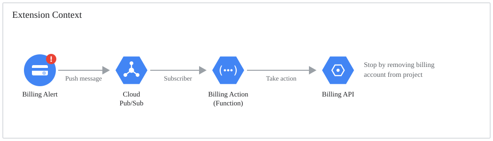

# How does it work?

At a high-level, the Auto Stop Services extension monitors a Budget you define and will take action when the project cost has met the defined budget.

All Firebase services are usage based and, beyond their free tier limit, will generate cost to the project. The cost is monitored through a Billing Account where a project Budget is defined (in dollar terms).

A Budget can produce an Alert when specific thresholds (in percentage terms) are met - for example a $100 budget will default to a 50%, 90%, and 100% threshold. At each threshold the Budget will generate an Alert - though the Google Cloud Platform documentation indicates there may be several Alerts generated and not always when the threshold is met, but let's not worry about that.

There is a separate threshold defined in the Auto Stop Services extension, which we will call the Extension Threshold. This is the percentage threshold of your budget that must be met for the Auto Stop Services to actually kick into gear and stop your project services. This defaults to 100%, so if your project cost meets or exceeds your budget, your project services will stop.

Auto Stop Services will receive the Alert via a Pub/Sub topic, and if it meets or exceeds the user defined threshold it will remove the Billing Account from your project (see below).

## Workflow

The general process is that a Budget raises an Alert which is fed into a Firebase Function (via a Pub/Sub topic). The Function will check that the threshold is met and will stop services if the threshold is met, otherwise nothing.

**Case 1 - Alert raised, below Extension Threshold**

Given we have a budget of $100 and our Extension Threshold is 100%
When our project cost is $50 (i.e. 50% of budget)
Then we do nothing

**Case 2 - Alert raised at Extension Threshold**

Given we have a budget of $100 and our Extension Threshold is 100%
When our project cost is $100 (i.e. 100% of budget)
Then we remove the Billing Account from the project.

**Case 3 - Alert raised above Extension Threshold**

Given we have a budget of $100 and our Extension Threshold is 100%
When our project cost is $110 (i.e. 110% of budget)
Then we remove the Billing Account from the project.

> Note: There is a limitation of Billing on Google Cloud Platform around timeliness of cost information. There *may* be delays in billing information for services from a few hours to a day. This is completely unavoidable.

## The stop action: removing the Billing Account

The extension disconnects the Billing Account from your project. Conceptually, Google Cloud Platform will only allow you to use services if a Billing Account is connected to your project. So, if we remove this connection - voila!

**What does this mean for your project?**

* **All paid services within the project are immediately suspended**. This includes compute instances, databases, and other cloud services that incur costs.
* **You can still access and view resources in the Google Cloud Console**, but you cannot create new resources or use services that require billing.
* **Data stored in services like Cloud Storage, Firestore, and databases is preserved** but may become inaccessible until billing is re-enabled.
* **Essential Google Cloud services remain available** for managing projects and restoring billing, this includes IAM and Google Cloud Console access.
* **Any pending charges will still be billed**. This includes those accrued before the billing account was removed, though no new charges will be generated until billing is re-established.

**How do you recover from this approach?**

Recovery is incredibly simple. You manually reconnect your Billing Account to the project. A full guide can be found on the [Recovery](recovery.html) page.

> Note: A Billing Account is a Google Cloud Platform concept. It is essentially an entity connected to your GCP/Firebase project which defines *how* you will pay for the services you utilise. If the link between these is cut, then GCP won't know how you will pay, thus will stop service usage.

## What happened to Strategy 2 (disabling individual services)?

Versions 1.x offered a second strategy that disabled selected Google Cloud APIs instead of removing billing. Google's Service Usage API no longer allows disabling a service that still has resources in it - disable requests fail with:

> `FAILED_PRECONDITION: Resources are found when disabling service(s)... please delete the following resources first`

There is no flag to force it, and deleting your resources to work around it isn't something this extension should be doing. Google documents the behaviour [here](https://docs.cloud.google.com/service-usage/docs/hierarchical-service-activation/manage-enablement). Billing account removal was always the recommended strategy, and as of 2.0.0 it is the only one. See the [CHANGELOG](https://github.com/deep-rock-development/auto-stop-firebase-ext/blob/main/CHANGELOG.md) for full details and migration notes.
